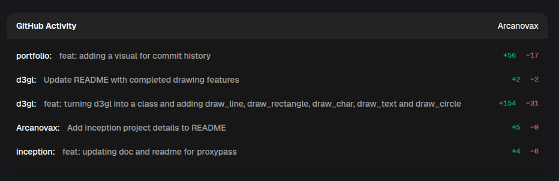

# Commits-Activity

React component + PHP script to display a user's latest GitHub commits.




## Structure

```
├── backend
│   ├── commits.json
│   ├── config.php
│   └── fetch-commits.php
└── commits.tsx
```


## Backend Configuration

In backend/fetch-commits.php, set:

- `USERNAME`
- `MAX_COMMITS`

Create backend/config.php with the token:

`<?php return ‘TOKEN_GITHUB’;`

Then run:

```
php backend/fetch-commits.php
```


## Scheduled Execution (cron)

Crontab example (every 30 minutes):

```
*/30 * * * *  php backend/fetch-commits.php >> /var/log/commits-activity.log 2>&1`
```

The frontend then reads backend/commits.json.


# Example page:

https://matisse-dev.me/commits
